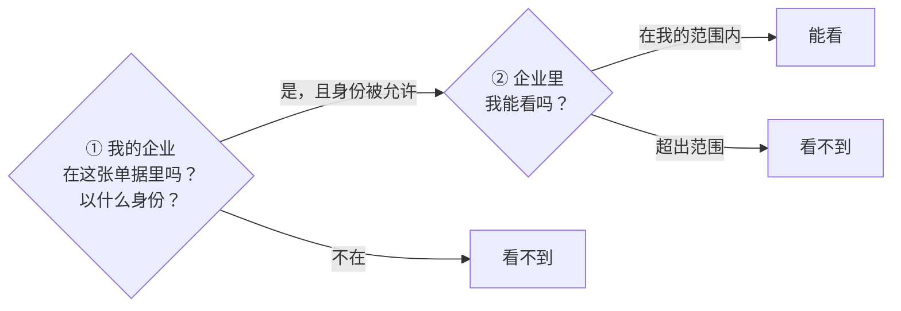
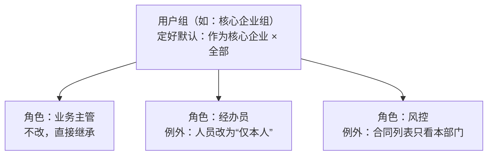
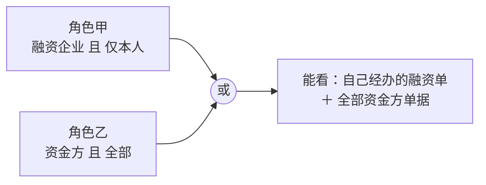
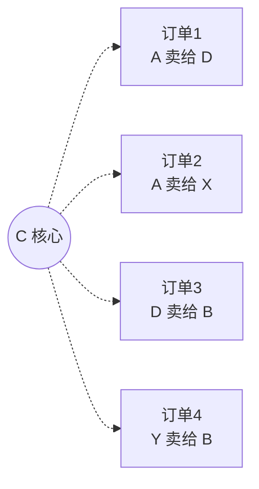

# qianrong 数据权限 · 设计思路

> **一句话**：谁能看哪条数据，只问两个问题——**“你的企业在这条数据里是什么身份”**和**“企业里哪些人能看”**。
> 把这两个问题做成选择题，默认值放在用户组上，角色只处理例外。

---

## 一、先把问题想清楚

供应链金融里，一张单据（准入、授信、合同……）上天然写着几方：核心企业、融资企业、资金方、监管方。
所以“能不能看”其实就是两层判断：

| 问题 | 怎么选 | 举例 |
| --- | --- | --- |
| ① 身份 | 多选：作为核心企业 / 作为融资企业 / 作为资金方 / 作为监管方 | 银行只勾“作为资金方” |
| ② 人员 | 单选：全部 / 本部门 / 本部门及下级 / 指定部门 / 仅本人（就是现在已有的数据范围） | 经办员选“仅本人” |

**原方案的做法**是让管理员自己拼条件（“某字段 等于 某值，或者……”）。自由度高，但开发要做一整套规则引擎，运营也看不懂、容易配错。
**我们的业务方就这几类，两个选择题就能覆盖全部场景。**

---

## 二、五个核心设计

### 1. 企业隔离是底线，不让配置

企业账户永远只能看到“本企业参与的数据”。这一条由系统自动执行，不出现在配置界面，也就不会被误配掉。
（现在角色数据权限里已经去掉了“本企业”选项，方向一致。）

### 2. 合作关系直接从单据上读

原方案要维护一张“企业关系网”（谁是谁的上下游），再推算可见范围。
其实单据上已经写着核心企业、资金方是谁——**业务录单的那一刻，权限就已经确定了**，不需要权限模块再登记一遍关系。

### 3. 用户组定默认，角色只管例外

- 企业本来就绑定用户组，**新企业入驻后什么都不用配**，直接带上组的默认规则。
- 改用户组的默认值，名下没设例外的角色**自动跟着变**。
- 角色上只记录“和组不一样的地方”，随时可以“恢复继承”。

> 原方案有“策略包 + 企业层 + 用户组层 + 角色层”四套东西；这里只剩**用户组**和**角色**两个概念。

### 4. 字段也是“默认 + 例外”

| 层 | 作用 |
| --- | --- |
| 菜单的列字段 | 定每个字段的默认值：可见 / 脱敏 / 隐藏 |
| 角色（后续可加用户组） | 只记录与默认不同的字段 |

- **新上线的字段默认隐藏**，平台确认后才放开，不会因为忘配而泄露。
- 去掉现在“每个角色先导入一遍列字段再改”的步骤——导入是复制，菜单后来加的字段角色那边不会同步。
- 列表、详情、导出用同一套设置，不会出现“列表藏了、导出却能拿到”。

### 5. 一个人有多个角色时

每个角色先各自算出“身份 且 人员”，再把各角色的结果合起来：

⚠️ 不能把两个问题拆开分别合并，否则会变成“融资企业 + 资金方 × 全部”，经办员就能看到全部融资单了。

字段同理：多个角色中只要有一个能看就能看，都要脱敏时取更严的脱敏方式。

---

## 三、用一个例子串起来

四张订单，C 是核心企业，D 对 A 是买方、对 B 是卖方（订单上有买方、卖方、核心企业三方，所以身份选项就是这三个）：

| 企业 | 需要配置什么 | 看到 |
| --- | --- | --- |
| A | 不用配 | 订单 1、2 |
| B | 不用配 | 订单 3、4 |
| C | 勾“作为核心企业” | 全部 4 张 |
| D | 勾“作为买方”+“作为卖方” | 订单 1、3（A 卖给别人的、B 从别人那买的都看不到） |

再叠加字段设置：D 能看到订单，但成本价、平台底价这类字段默认就是隐藏的。
**行控制看哪些单据，字段控制看到多深。**

---

## 四、运营同学的体验

| 操作 | 之前 | 现在 |
| --- | --- | --- |
| 新企业入驻 | 逐个角色配数据范围、导入列字段 | 绑定用户组即可，零配置 |
| 经办员只看自己的 | 改角色整体范围，影响所有列表 | 角色上改一项，其余继承 |
| 某个列表要特殊处理 | 无法单独设置 | 给这个列表加一条例外 |
| 新字段上线 | 每个角色各配一遍 | 默认隐藏，菜单里放开一次 |
| 想知道某角色能看什么 | 只能找人问 | 每行标注来源（继承 / 例外），并可预览真实数据 |

另外提供一张**按列表看的总览**：一个列表下，各用户组分别能看什么范围、哪些字段被隐藏，一屏看完。
行用用户组而不是角色——角色挂在各个企业下，会有成百上千个，按组才看得过来。

---

## 五、刻意不做的事

| 不做 | 原因 |
| --- | --- |
| 自由拼条件的规则编辑器 | 开发成本最高、运营最难用；真有特殊需求（如“只看大额单据”），做成一个可勾选的选项 |
| 企业关系网 | 关系已经在单据上 |
| 独立的“策略包” | 用户组就是策略包 |
| 规则的“待确认 / 已失效”等状态流转 | 规则只能从固定选项里选，不存在“引用的字段没了”这种问题；取消查询权限时规则先保留，重新开放后自动恢复 |

---

## 六、分三步上线

1. **先能用**：企业隔离、角色“默认 + 列表例外”、字段改成“默认 + 例外”，先覆盖准入、授信、项目方案、合同几个核心列表。没配置的角色行为和今天完全一样。
2. **再好用**：用户组默认规则、按列表的总览、预览；平台人员可以只看指定产品或指定银行的数据。
3. **最后收口**：其余列表全部接入后，没接入的列表对企业账户默认不展示数据。
