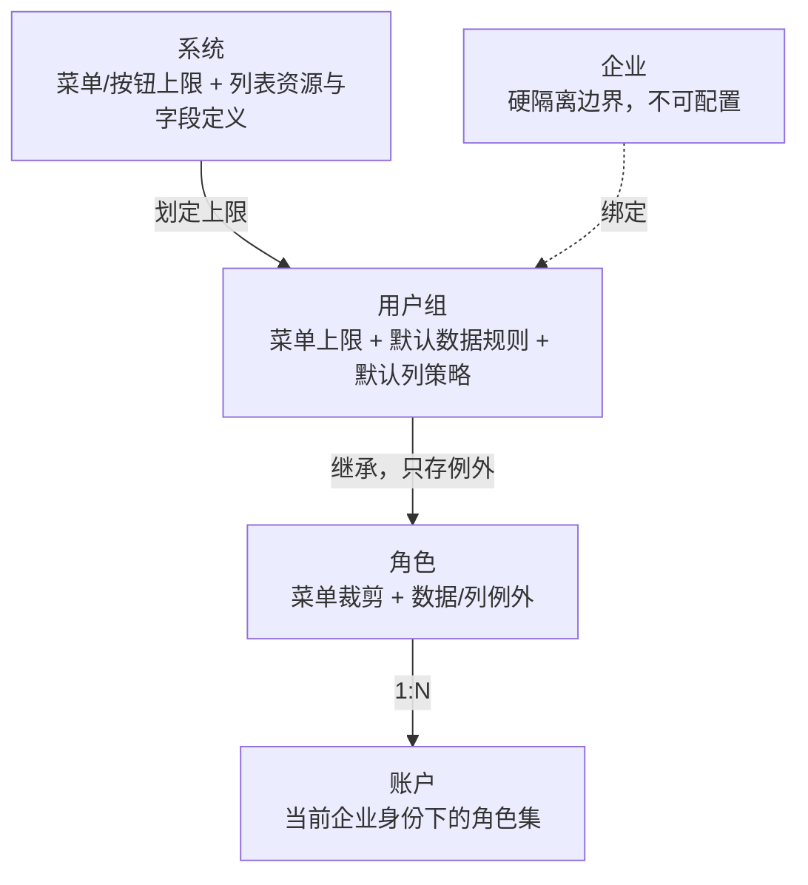

# 业务权限体系与细粒度数据过滤方案设计规范

> 2026-10-30 评审修订：结合 qianrong（tq-plus dev/ef20279）现有实现重新审视原方案，在“开发难度低、自由度够用、复用性强、运营好上手”四个目标间做了取舍。第 0 节是结论，后续各节已按结论改写；原方案中被替换的设计集中列在第 9 节，便于对照。

---

## 0. 评审结论

**总体判断**：原方案的分层思路（系统 → 用户组 → 角色，功能 / 行 / 列三维）方向正确，且与 qianrong 已落地的菜单继承链一致；问题集中在**行级规则做成了通用表达式引擎**、**策略包 + 三层继承 + 业务关系网络三套复用机制叠加**，开发和运营成本都会被放大，而 qianrong 的真实业务主体是固定的几类，用不到这么高的自由度。

| # | 原方案 | 优化后 | 开发 | 运营 | 复用 |
| --- | --- | --- | --- | --- | --- |
| 1 | “本企业”作为可选预设档 / 默认策略包 | **企业隔离是系统硬边界**，企业账户永远只能看本企业参与的数据，不进入配置项（与 10-26 已去掉“本企业”选项的现状一致） | 少一档规则 | 不会漏配、错配 | — |
| 2 | 自定义条件组：字段 + 操作符 + 值，组间 OR、组内 AND | **两维选择题**：主体维度（本企业在单据中以什么身份参与，多选）× 人员维度（沿用现有 dataScope 五档）。表达式构建器不做 | 不用做字段元数据、操作符校验、SQL 拼接防注入 | 两个下拉/勾选，零学习成本 | 规则与具体表字段解耦，换列表照样适用 |
| 3 | `$MY_DOWNSTREAM_ORGS$` 等变量依赖“企业关系网络”动态计算 | **关系就在单据字段上**（核心企业、融资企业、资金方、监管方字段），开发在接口上声明一次，运行时直接按字段过滤 | 不建关系图、不做缓存与失效 | 业务录单即生效，无需维护合作关系 | 一次声明，所有角色共用 |
| 4 | 独立的“数据权限策略包”资产 + 企业 / 用户组 / 角色三层继承 | **用户组就是策略包**：用户组上配默认数据规则，角色只存“例外”；企业层并入用户组（企业本来就绑定用户组） | 少一个实体、少一层继承解析 | 概念只剩“用户组 / 角色”两个 | 改用户组默认，名下所有角色自动跟随 |
| 5 | 列级策略按角色整份配置；现状是“导入菜单列字段”整份复制 | **菜单列字段即默认策略，角色只存差异行**；新字段自动走菜单默认（HIDDEN） | 去掉导入/复制，后端合并一次 | 不用逐角色导入、不怕漏同步新字段 | 一份默认全平台复用 |
| 6 | 四态规则状态机（未配置 / 生效 / 待确认 / 失效） | **不维护规则状态**：查询权关闭时规则休眠但保留；字段消失时差异行自然失效 | 无状态流转、无修复流程 | 无“待确认”运维负担 | — |
| 7 | 反向矩阵按“全平台所有角色”铺开 | **矩阵行是用户组**，角色例外以角标展示、可展开 | 数据量可控 | 角色按企业挂载，可能成百上千，按组看才看得完 | — |
| 8 | 多角色行规则“取宽松 OR 拼接” | 明确为**按角色整体 OR**（每个角色内部两维先 AND），不能按维度分别取并集，否则会越权 | — | — | — |
| 9 | 列表与接口的对应由前端维护（`preview-sources.js` 23 条） | **列表资源码 = 菜单权限标识前缀**（如 `access:coreOrg`），后端注解与菜单共用，列表 / 详情 / 导出天然同一资源 | 不新增字段、不维护前端对照表 | — | 预览、列策略、行规则共用一个键 |

**一句话**：行级用“身份 × 人员”两维选择替代表达式，列级用“菜单默认 + 角色差异”替代整份复制，复用全部收敛到已有的用户组上；开发侧每个列表只需一行后端注解，前端一个配置组件在用户组与角色两处复用。

---

## 1. 业务背景与系统现状

### 1.1 已有基础（以 qianrong 当前实现为准）

$$\text{系统（System）} \longrightarrow \text{用户组（User Group）} \longrightarrow \text{角色（Role）} \longrightarrow \text{用户账号（User）}$$

| 层 | 现状 |
| --- | --- |
| 系统 | 菜单授权上限，`/system/detail` 的 menuIds |
| 用户组 | 关联系统并在系统授权内勾选菜单（`groupsSystemMenuDTOList[{systemId,menuList}]`）；**企业绑定用户组（多选 userGroupIds）** |
| 角色 | 归属企业 + 用户组（必选），菜单只能在用户组范围内选（`menuTreeList`） |
| 账户 | 账户类型 00 平台管理员 / 01 平台用户 / 02 企业管理员 / 03 企业用户，可多角色，支持切换企业身份 |
| 行级 | 角色整体 `dataScope` 单选（全部 / 自定义部门 / 本部门 / 本部门及以下 / 本人），无列表维度；“本企业”已从可选项去掉 |
| 列级 | 菜单列字段 7 接口（字段名、编码、类型、默认策略 policy、maskType，新建默认 HIDDEN）；角色列字段 6 接口（需“导入菜单列字段”整份复制后再改） |
| 预览 | 角色配置权限页调用列表接口并多传 `previewRoleId`；列表与接口对应关系由前端写死 |

### 1.2 业务主体

qianrong 的参与方是固定的几类（`ORG_KIND`）：**核心企业、融资企业、监管方、监管仓库、资金方（银行）**，外加平台方。业务单据（准入、授信、项目制方案、合同等）天然带有这些参与方字段。因此数据可见性的本质是：

> 当前企业**以什么身份**出现在这张单据上 → 能不能看；能看的前提下，企业内**哪些人**能看 → 部门 / 本人。

### 1.3 现有痛点

1. 数据范围是角色级全局单选，不能按列表区分（例如风控岗看全部授信，但只看本人经办的合同）。
2. 没有“按参与身份”切片的能力，同一企业在不同单据里身份不同（既是融资方又是核心企业）时无法表达。
3. 列字段要逐角色导入复制，菜单新增字段后各角色不会同步，配置量随角色数线性增长。

---

## 2. 权限分层体系设计



### 核心规则约束
1. **天花板校验**：菜单沿用现有系统 ∩ 用户组 ∩ 角色；数据规则同理，角色可选的参与身份不超过用户组允许的范围。
2. **企业硬隔离**：企业账户（02/03）的任何查询都至少附加“本企业是该单据某一参与方”，由后端统一注入，不出现在配置界面；平台账户（00/01）不受此限。
3. **按当前身份计算**：只合并当前登录企业身份下的角色。

---

## 3. 三维权限设计

### 3.1 功能权限（菜单与按钮）
沿用现有 `MenuPermissionTree`“权限名称 / 操作权限”两列表格（系统、用户组、角色三处已复用），不改。

### 3.2 行级数据权限：身份 × 人员

一条行规则 = **主体维度 AND 人员维度**：

| 维度 | 选项 | 说明 |
| --- | --- | --- |
| 主体维度（多选） | 作为核心企业 / 作为融资企业 / 作为资金方 / 作为监管方 / 作为监管仓库；平台账户另有“全平台” | 只展示该列表**声明过**的身份；多选之间为 OR |
| 人员维度（单选） | 全部 / 本部门 / 本部门及以下 / 指定部门 / 仅本人 | 即现有 dataScope 五档，后端实现直接复用 |

- **作用范围**：用户组和角色各有一条“默认规则”（对所有列表生效），需要时再对个别列表设“例外规则”。绝大多数角色只配默认规则甚至不配。
- **平台账户扩展（第二阶段）**：平台用户的主体维度可从“全平台”收窄为“指定产品 / 资金方 / 监管方”。现有 dataScope DTO 中已有 `productIds / regulatoryIds / bankIds` 字段，可沿用该方向。
- **不做**：自由的字段 + 操作符 + 值表达式。确有个别列表需要特殊过滤（如“只看金额 ≥ 1000 万”），由开发在该列表注解里定义一个具名选项（如“大额单据”），运营仍是勾选，不写表达式。

### 3.3 列级数据权限：菜单默认 + 差异覆盖
- **三态不变**：VISIBLE / HIDDEN / MASKED；MASKED 支持 FULL、KEEP_FIRST_LAST。
- **默认值在菜单列字段上**（已有 policy、maskType），新字段默认 HIDDEN（Fail-Closed，已实现）。
- **角色只存与默认不同的字段**，生效值 = 角色差异 ?? 用户组差异（第二阶段）?? 菜单默认。去掉“导入菜单列字段”这一步；界面展示全量字段，与默认不同的高亮，可“恢复默认”。
- **脱敏方式跟随字段类型**：在菜单列字段的 fieldType 上约定语义（手机号、证件号、银行卡、金额），脱敏方式随类型自动给默认值，运营通常只需选三态。
- **生效位置**：后端在列表、详情、导出三处按同一资源码统一处理响应（见 7.1）；前端隐藏只是展示配合，不承担安全。

---

## 4. 场景推演

### 4.1 通用多边场景（原 A/B/C/D 示例）

单据带 `seller_org_id / buyer_org_id / core_org_id` 等参与方字段，开发在该列表声明为“卖方 / 买方 / 核心企业”身份。

| 主体 | 目标 | 配置 | 实际过滤 |
| --- | --- | --- | --- |
| A、B | 只看自己参与的 | 无需配置（企业硬隔离 + 用户组默认身份） | 本企业出现在任一参与方字段 |
| C | 作为核心企业看 A、B 的相关单据 | 主体：作为核心企业 | `core_org_id = 当前企业`，不需要计算“下游企业列表” |
| D | 对 A 是买方、对 B 是卖方 | 主体：作为买方 + 作为卖方 | `buyer_org_id = D OR seller_org_id = D`，A 卖给他人、B 从他人采购的单据自然被排除 |

D 场景在原方案里要配两个条件组，这里是勾两个选项；C 场景不再依赖关系网络，单据上有核心企业字段即可。

### 4.2 qianrong 映射

| 用户组（企业类型） | 默认行规则 | 典型列策略 |
| --- | --- | --- |
| 融资企业组 | 作为融资企业 × 全部 | 平台内部费率、资金方底价 HIDDEN |
| 核心企业组 | 作为核心企业 + 作为融资企业 × 全部 | 融资企业联系人手机 MASKED |
| 资金方（银行）组 | 作为资金方 × 全部 | 平台服务费明细 HIDDEN |
| 监管方组 | 作为监管方 × 全部 | 金额类 VISIBLE，证件号 MASKED |
| 平台运营组 | 全平台 × 全部 | 全部 VISIBLE |
| 角色例外示例：企业经办员 | 继承组身份 × **仅本人** | 继承 |

### 4.3 行控范围、列控深度
D 能看到交易单据，但上游成本、平台底价等字段在菜单默认里就是 HIDDEN，只有平台组放开；联系人手机号、证件号默认 MASKED。

---

## 5. 运营便利

### 5.1 用户组即策略包
- 用户组页面新增“数据权限”页签，复用角色配置权限页的同一组件：默认行规则、列表例外、列策略差异。
- 新企业绑定用户组后即获得该组的菜单与数据规则，**新增企业零配置**。
- 修改用户组默认规则，名下所有未设例外的角色立即跟随；保存前提示受影响的角色数。

### 5.2 角色只做例外
- 角色配置权限页的行级、列级默认显示“继承自用户组 XX”，只有改动时才产生例外，并可一键“恢复继承”。
- 提供“从其他角色复制例外”“批量应用到同组角色”，代替独立的模板实体。

### 5.3 关系随业务自动生效
参与方身份读的是单据字段，准入、立项、签约时写入的核心企业 / 资金方 / 监管方就是权限依据，不存在“权限模块里再登记一次合作关系”的步骤。

### 5.4 列表视角矩阵

```
┌──────────────────────────────────────────────────────────────────────────────┐
│ 菜单管理 > 核心企业准入列表 (access:coreOrg) · 数据权限                      │
├──────────────┬────────────────────────────┬──────────────────────────────────┤
│ 用户组       │ 行规则                     │ 列策略（与默认不同项）           │
├──────────────┼────────────────────────────┼──────────────────────────────────┤
│ 平台运营组   │ 全平台 × 全部              │ —                                │
│ 资金方组     │ 作为资金方 × 全部          │ 平台服务费: 隐藏                 │
│ 核心企业组 ③ │ 作为核心企业 × 全部        │ 联系人手机: 脱敏                 │
│   └ 角色例外 │ 经办员: 作为核心企业×本人 … │                                  │
└──────────────┴────────────────────────────┴──────────────────────────────────┘
```
行是用户组（数量有限），③ 表示有 3 个角色设了例外，点开查看。入口放在菜单管理“列字段设置”旁（同样只对 C 类“列表”菜单显示）。

### 5.5 权限预览
沿用现有 `previewRoleId` 方案，但由后端拦截器统一识别：以目标角色身份执行同一套行、列处理并返回样本。前端不再维护列表与接口的对照表，可预览列表 = 角色已授权且已声明资源码的列表。

---

## 6. 安全闭环

1. **多角色合并**：
   - 功能权限：并集。
   - 行级：`(角色1主体 AND 角色1人员) OR (角色2主体 AND 角色2人员) …`，**按角色整体 OR**。反例：角色1“融资企业 × 本人”、角色2“资金方 × 全部”，若按维度分别并集会变成“(融资企业 OR 资金方) × 全部”，越权看到融资企业的全部数据。
   - 列级：三态取最宽（VISIBLE > MASKED > HIDDEN）；同为 MASKED 时取最严方式（FULL 优先）。
2. **查询权关闭**：规则保留不删、也不改状态，没有查询权本就访问不到；重新开启即恢复，无需确认流程。
3. **字段变化**：主体身份字段由开发在代码中声明，随版本走，不会出现运营配置引用了不存在字段的情况；列策略差异行对应的字段被删除时直接忽略，新字段走菜单默认 HIDDEN。
4. **未声明列表**：企业账户访问未声明参与方的业务列表时，第一阶段保持现状并在后台日志告警；全部列表声明完成后切换为返回 0 条（Fail-Closed）。字典、公告等公共数据显式标记为“公共”。
5. **鉴权在后端**：行过滤、列处理、天花板校验都在服务端；前端只做展示与输入约束。

---

## 7. 开发落地

### 7.1 后端
- **资源码**：取菜单权限标识前缀，如列表 `access:coreOrg:list`、详情 `access:coreOrg:detail`、导出同前缀 → 资源码 `access:coreOrg`。不新增菜单字段，列表 / 详情 / 导出共用一套行列规则。
- **一个注解 + 一个拦截器**：在现有 dataScope 切面基础上扩展，例如
  `@DataPermission(resource = "access:coreOrg", parties = {CORE = "t.core_org_id", FINANCER = "t.org_id"}, dept = "d", user = "u")`
  拦截器按“企业硬隔离 → 合并后的行规则”拼 WHERE，响应序列化时按合并后的列策略隐藏 / 脱敏。每接入一个列表只加一行注解。
- **一张规则表**：`sys_data_rule(owner_type GROUP|ROLE, owner_id, menu_id 为空表示默认, parties, person_scope, dept_ids)`。人员维度沿用 dataScope 取值与部门树接口。
- **列策略**：复用菜单列字段、角色列字段两套表与接口，语义改为“角色只存差异”；`/role/column/import` 保留兼容但不再是必经步骤；第二阶段用户组差异可沿用角色列字段表加 owner_type。
- **元数据接口**：按菜单返回该列表声明的参与身份（供前端渲染可选项）。
- **缓存**：合并后的规则按“账户 + 当前企业”缓存，用户组 / 角色规则保存时失效。

### 7.2 前端
- 一个 `DataPermissionPanel`（行规则 + 列策略差异），在角色配置权限页与用户组页复用，替换角色页目前不落库的前端模型（`permission-workspace-model`）与现有行级 dataScope 面板。
- 列表视角矩阵复用同一组件的只读 / 批量模式，挂在菜单管理。
- 删除 `preview-sources.js` 对照表，预览改走资源码。

---

## 8. 实施分期

1. **第一阶段（最小可用）**：注解 + 拦截器 + 规则表；角色“默认规则 + 列表例外”；企业硬隔离；列策略改为差异语义。现有 `dataScope` 作为人员维度原样保留，未配置的角色行为不变。先接准入、授信、项目制方案、合同四类核心列表。
2. **第二阶段（复用与运营）**：用户组默认规则与列策略差异；列表视角矩阵；平台账户“指定产品 / 资金方 / 监管方”；后端统一预览。
3. **第三阶段（收口）**：其余列表补齐声明后切换未声明列表 Fail-Closed；按需增加具名特殊选项。

---

## 9. 原方案中被替换或延后的设计

| 原设计 | 处理 | 理由 |
| --- | --- | --- |
| 可视化条件构建器（字段 + 操作符 + 变量，组 OR / 组内 AND） | 不做，改为具名选项 | 开发成本最高、出错面最大；qianrong 主体类型固定，两维选择已覆盖原文全部场景 |
| `$MY_DOWNSTREAM_ORGS$` 与合作关系网络自动派发 | 不做 | 单据参与方字段已表达关系；若后续出现“核心企业看下游企业的非单据档案”，再以具名选项基于准入关系实现 |
| 独立策略包实体 | 并入用户组 | 企业已绑定用户组，再加一层只增加概念 |
| 企业层默认绑定（普通企业 / 链上伙伴不同默认包） | 并入用户组 | 企业类型差异由所绑定的用户组表达 |
| “本企业”预设档 | 改为系统硬边界 | 与现状一致，避免运营误把企业隔离配掉 |
| 规则四态状态机、Schema 漂移修复流程 | 不做 | 规则不引用运营自填字段后，漂移问题不存在 |
| 全平台角色矩阵 | 改为用户组矩阵 | 角色随企业增长，按组才可运营 |
