# qianrong 权限体系与数据权限过滤 · 产品设计方案

| 项目 | 内容 |
| --- | --- |
| 适用范围 | 泰乾超级-qianrong（系统、用户组、角色、账户、各业务列表） |
| 版本 | v2.0（2026-10-30，基于 v1.0 全景方案评审修订，按 tq-plus dev/ef20279 现状对齐） |
| 状态 | 方案稿，待后端评审接口与数据表 |
| 阅读对象 | 产品、前后端开发、平台运营 |

**目录**

1. 一页结论
2. 背景与目标
3. 用户角色与核心场景
4. 概念模型
5. 权限规则设计
6. 关键流程
7. 状态设计
8. 页面与交互
9. 场景推演
10. 异常与安全
11. 开发落地与分期
12. 附录：v1.0 设计取舍对照

---

## 1. 一页结论

> **行级用“身份 × 人员”两项选择代替表达式，列级用“菜单默认 + 角色差异”代替整份复制，复用全部收敛到已有的用户组上。**
> 开发侧每个列表只加一行后端注解；前端一个配置组件，在用户组与角色两处复用；运营侧新企业入驻零配置。

| 设计点 | v1.0 | v2.0 | 收益 |
| --- | --- | --- | --- |
| 企业隔离 | “本企业”是可选预设档 | 系统硬边界，不可配置 | 不会被误配掉 |
| 行级规则 | 字段 + 操作符 + 值，条件组 OR / 组内 AND | 参与身份（多选）× 人员范围（单选） | 免做表达式引擎；运营只需勾选 |
| 合作关系 | 维护企业关系网络，动态计算下游企业 | 直接取单据上的参与方字段 | 业务录单即生效 |
| 复用 | 策略包 + 企业 / 用户组 / 角色三层继承 | 用户组即策略包，角色只存例外 | 概念只剩两个 |
| 列级 | 逐角色整份配置（现状需“导入菜单列字段”） | 菜单默认 + 角色差异 | 新字段自动兜底 |
| 规则状态 | 四态状态机 + 字段漂移修复 | 只有派生的显示状态，不存库 | 无修复流程 |
| 多角色合并 | 行规则“取宽松” | 按角色整体 OR | 修正越权漏洞 |
| 列表与接口对应 | 前端维护 23 条对照 | 资源码 = 菜单权限标识前缀 | 列表 / 详情 / 导出共用 |

---

## 2. 背景与目标

### 2.1 现状

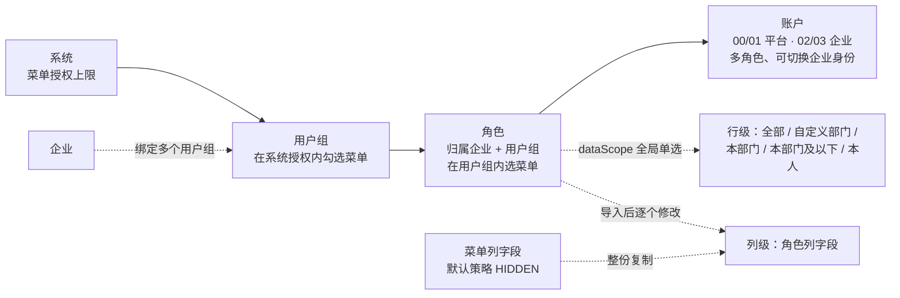

| 能力 | 已有 | 缺口 |
| --- | --- | --- |
| 功能权限 | 系统 → 用户组 → 角色逐层收窄，权限两列表格三处复用 | — |
| 行级 | 角色级 dataScope 五档（“本企业”已从选项中去掉） | 不能按列表区分；不能按参与身份切片 |
| 列级 | 菜单列字段 7 接口、角色列字段 6 接口，三态 + 两种脱敏 | 角色要整份导入；菜单新增字段不会同步给角色 |
| 预览 | 调列表接口并多传 `previewRoleId` | 列表与接口的对应关系写死在前端 |

### 2.2 业务主体

qianrong 的参与方是固定的几类：

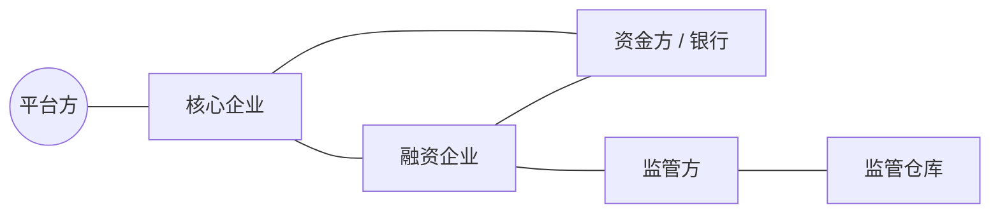

业务单据（准入、授信、项目制方案、合同等）天然带有这些参与方字段。因此数据可见性归结为两个问题：

1. 当前企业**以什么身份**出现在这张单据上？——决定能不能看；
2. 企业内部**哪些人**能看？——决定部门 / 本人范围。

### 2.3 设计目标与非目标

| 目标 | 衡量方式 |
| --- | --- |
| 开发简单 | 接入一个列表 = 加一行注解，不写过滤 SQL |
| 自由度够用 | 覆盖“按列表区分”“按身份切片”“按人员收窄”“字段隐藏 / 脱敏” |
| 复用性强 | 一处默认，多处继承；改默认，未设例外的角色自动跟随 |
| 运营便利 | 新企业零配置；典型配置不超过两次选择 |

**非目标**：不做通用规则引擎和表达式编辑器；不建企业关系网络；不做字段级审批流。

---

## 3. 用户角色与核心场景

### 3.1 谁配置什么

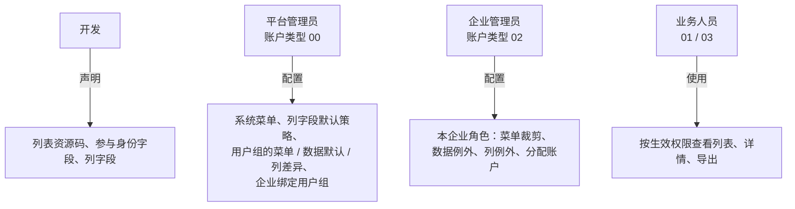

### 3.2 核心场景

| 编号 | 场景 | 期望体验 |
| --- | --- | --- |
| S1 | 新的融资企业入驻 | 绑定“融资企业组”后立即可用，不进权限模块 |
| S2 | 企业经办员只看自己经办的单据 | 角色上把人员范围改成“仅本人”，一次选择 |
| S3 | 风控岗看全部授信，但合同只看本部门 | 角色默认“全部”，对合同列表设一个例外 |
| S4 | 资金方不能看到平台服务费 | 在资金方组的列策略里把该字段设为隐藏 |
| S5 | 业务新上线一个字段 | 自动隐藏，平台管理员在菜单列字段放开一次即可 |
| S6 | 想确认某角色到底能看到什么 | 在配置页一键预览真实样本 |

---

## 4. 概念模型

### 4.1 分层

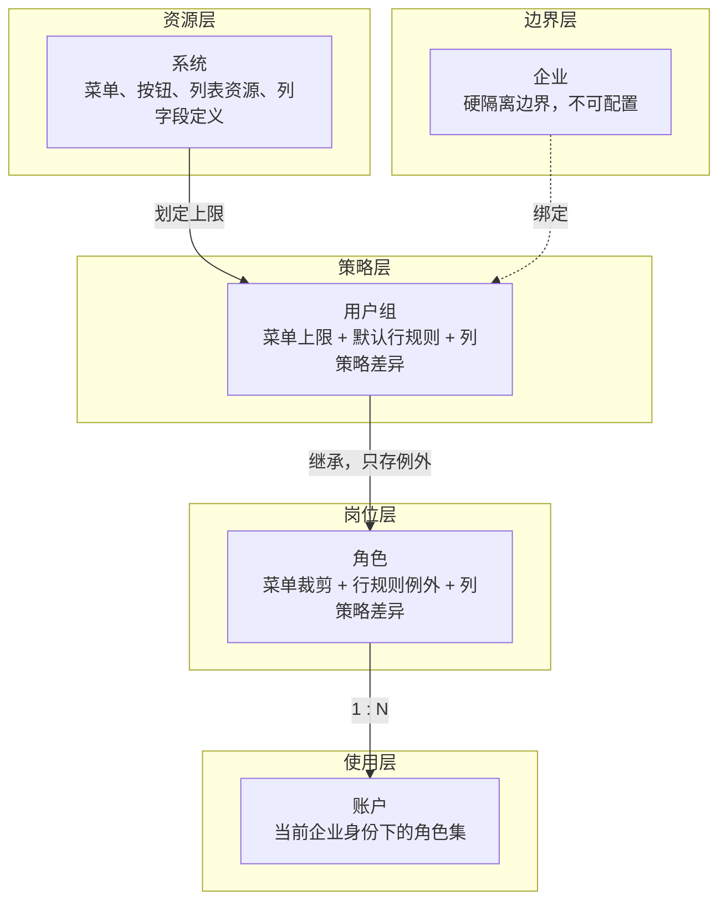

### 4.2 术语

| 术语 | 定义 |
| --- | --- |
| 列表资源 | 菜单中的 C 类“列表”页面；资源码取其权限标识前缀，如 `access:coreOrg:list` → `access:coreOrg`，同前缀的详情、导出共用 |
| 参与身份 | 本企业在单据中的身份，如核心企业、融资企业、资金方、监管方、监管仓库；由开发按单据字段声明 |
| 人员范围 | 全部 / 本部门 / 本部门及以下 / 指定部门 / 仅本人，即现有 dataScope |
| 行规则 | 参与身份 × 人员范围；有“默认规则”和“列表例外”两种 |
| 列策略 | 字段的 可见 / 脱敏 / 隐藏；默认值在菜单列字段上 |
| 例外 / 差异 | 角色或用户组上与上级不同的设置；没有差异即为继承 |
| 生效权限 | 当前企业身份下所有角色合并后的结果 |

### 4.3 数据模型

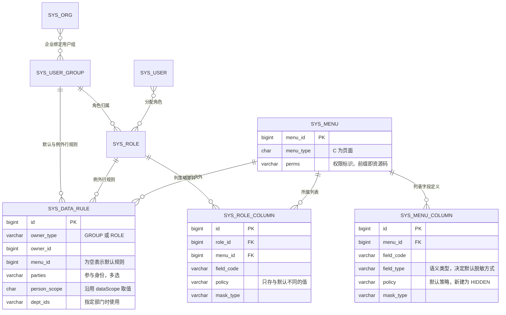

> 新增的只有 `SYS_DATA_RULE` 一张表；菜单列字段、角色列字段沿用现有表，角色列字段改为“差异”语义。用户组列策略差异在第二阶段沿用同表加 `owner_type`。

---

## 5. 权限规则设计

### 5.1 功能权限

沿用现有“权限名称 / 操作权限”两列表格与系统 ∩ 用户组 ∩ 角色的收窄规则，本方案不改。

### 5.2 行级：身份 × 人员

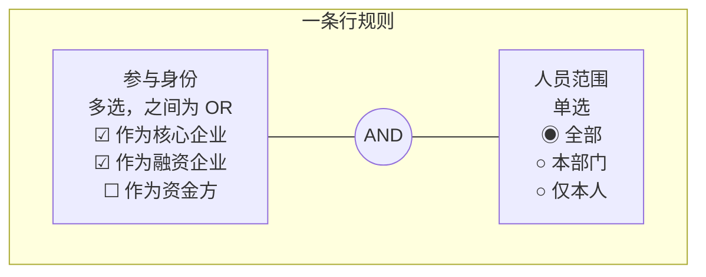

- 只显示该列表**声明过**的参与身份。
- 平台账户的参与身份为“全平台”；第二阶段可收窄为“指定产品 / 资金方 / 监管方”（现有 dataScope DTO 中已有 `productIds / regulatoryIds / bankIds` 字段，可沿用这个方向）。
- 个别列表的特殊过滤（如“大额单据”）由开发在注解中定义为**具名选项**，运营仍然只是勾选。

**规则查找顺序**（每个角色独立查找，命中即止）：

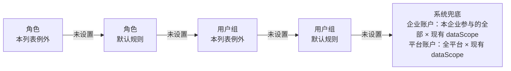

> 系统兜底等于今天的行为，所以第一阶段上线时，没配置的角色不受影响。

### 5.3 列级：菜单默认 + 差异


| 策略 | 列表 | 详情 | 导出 |
| --- | --- | --- | --- |
| 可见 VISIBLE | 正常显示 | 正常显示 | 输出 |
| 脱敏 MASKED | 掩码显示 | 掩码显示 | 输出掩码 |
| 隐藏 HIDDEN | 整列不显示 | 该项不显示 | 不输出该列 |

- 脱敏方式 FULL（`***`）或 KEEP_FIRST_LAST（`1101**********1234`），默认值由字段语义类型决定（手机号、证件号、银行卡、金额），运营通常只需选三态。
- 处理统一在后端响应环节完成；前端隐藏只是展示配合，不承担安全职责。

### 5.4 多角色合并

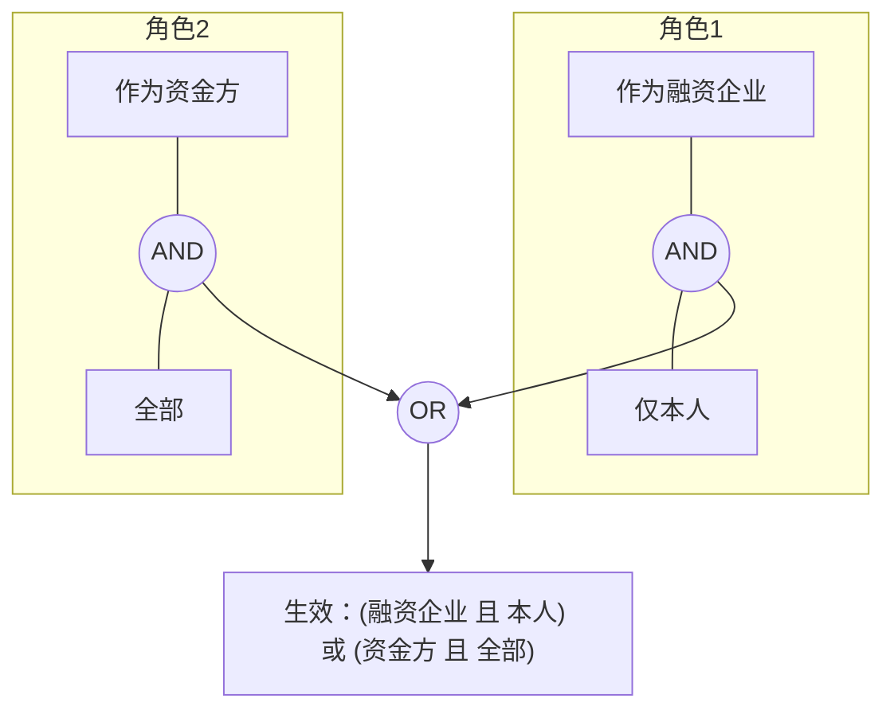

| 维度 | 合并方式 |
| --- | --- |
| 功能 | 并集 |
| 行 | 按角色整体 OR。**不能**按维度分别并集——上例若拆开合并会变成“(融资企业 或 资金方) × 全部”，越权看到融资企业的全部单据 |
| 列 | 三态取最宽：VISIBLE > MASKED > HIDDEN；同为 MASKED 时取最严方式（FULL 优先） |
| 范围 | 只合并当前登录企业身份下的角色 |

---

## 6. 关键流程

### 6.1 查询时的权限计算（运行时）

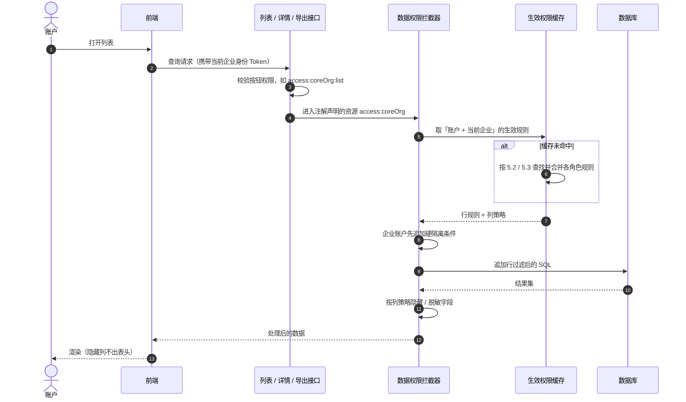

### 6.2 新企业入驻（场景 S1）

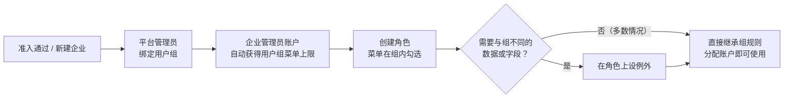

### 6.3 平台管理员修改用户组默认规则

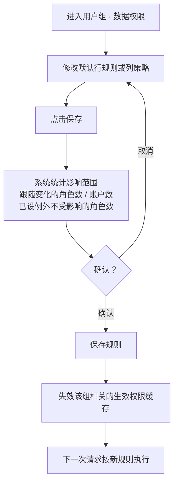

### 6.4 企业管理员为角色设例外（场景 S2 / S3）

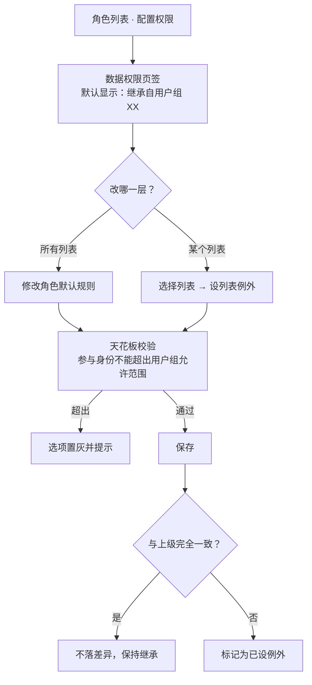

### 6.5 开发接入一个列表


### 6.6 切换企业身份

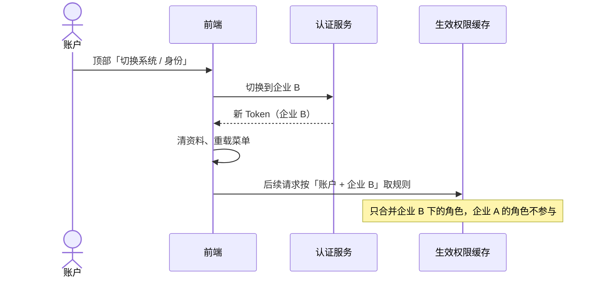

### 6.7 权限预览（场景 S6）

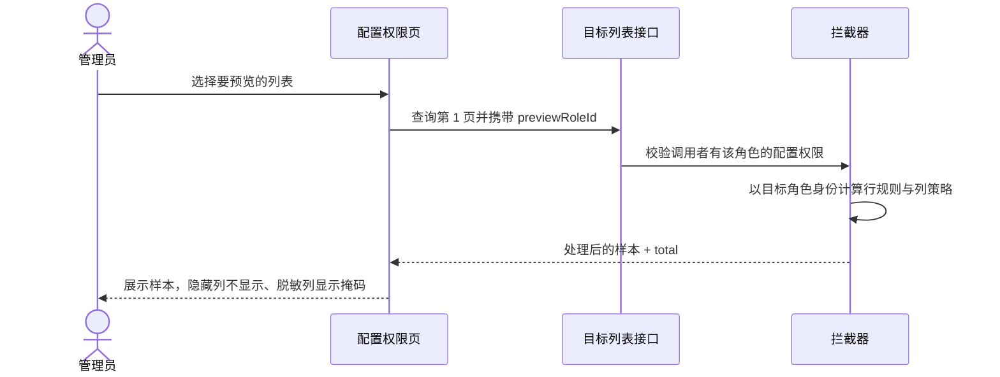

---

## 7. 状态设计

> 规则本身不存状态字段，下面的状态都由现有数据实时推导出来，用于界面展示和运营理解。

### 7.1 角色在某个列表上的规则状态

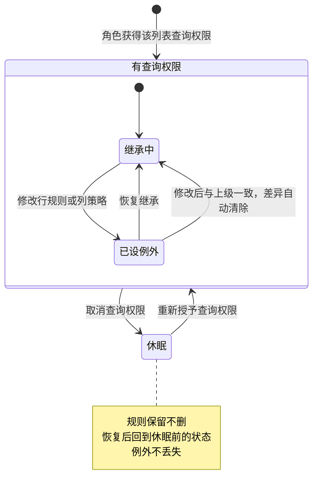

| 状态 | 界面表现 |
| --- | --- |
| 继承中 | 灰色标签“继承自用户组 XX”，选项显示上级的值 |
| 已设例外 | 蓝色标签“例外”，旁边有“恢复继承” |
| 休眠 | 该列表不出现在数据权限页签与预览中；重新勾选查询后恢复 |

### 7.2 列字段生命周期

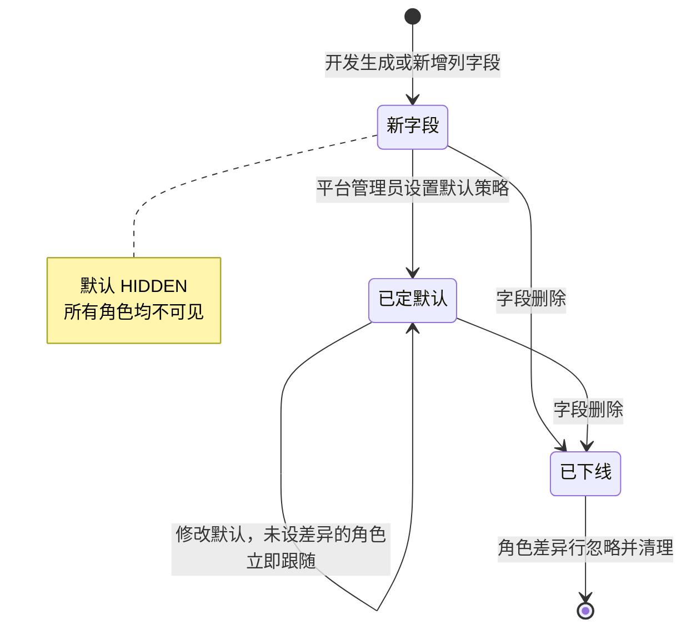

### 7.3 列表接入状态

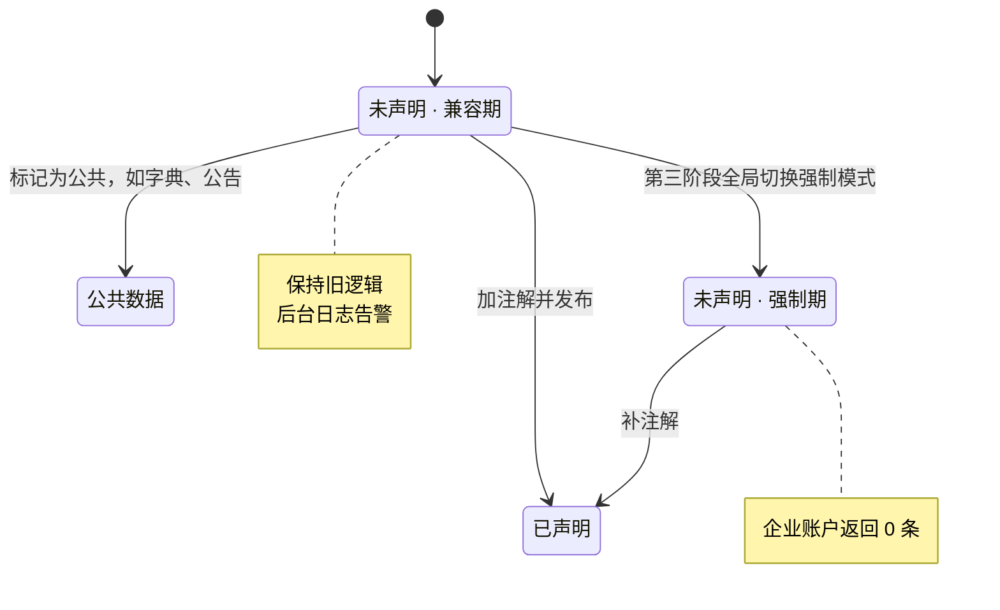

---

## 8. 页面与交互

### 8.1 信息架构

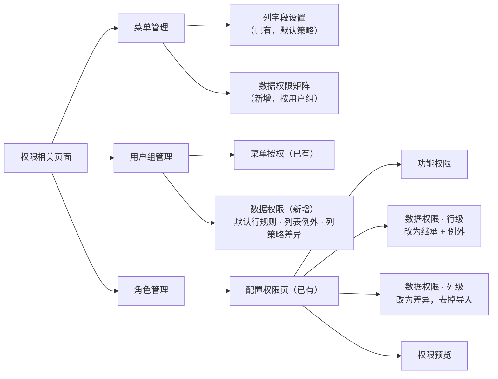

### 8.2 用户组 · 数据权限

```
┌──────────────────────────────────────────────────────────────────────┐
│ 用户组 > 核心企业组 > 数据权限                                       │
├──────────────────────────────────────────────────────────────────────┤
│ 默认行规则（对所有列表生效）                                         │
│   参与身份  ☑ 作为核心企业  ☑ 作为融资企业  ☐ 作为资金方  ☐ 作为监管方 │
│   人员范围  [ 全部                ▼ ]                                │
├──────────────────────────────────────────────────────────────────────┤
│ 列表例外                                         [ + 添加列表例外 ]  │
│   合同列表        作为核心企业 × 本部门                 编辑  删除   │
├──────────────────────────────────────────────────────────────────────┤
│ 列策略差异   列表 [ 核心企业准入列表 ▼ ]   ☐ 只看与默认不同           │
│   字段           默认      本组                                      │
│   联系人手机     可见      ● 脱敏（保留首尾）                         │
│   平台服务费     隐藏      隐藏                                      │
├──────────────────────────────────────────────────────────────────────┤
│                                          [ 取消 ]  [ 保存 ]          │
└──────────────────────────────────────────────────────────────────────┘
```

### 8.3 角色 · 配置权限 · 数据权限（行级）

```
┌──────────────────────────────────────────────────────────────────────┐
│ 功能权限 │ 数据权限·行级 │ 数据权限·列级 │ 权限预览                   │
├──────────────────────────────────────────────────────────────────────┤
│ 角色默认规则                         [继承自 核心企业组]              │
│   参与身份  ☑ 作为核心企业  ☑ 作为融资企业  ☐ 作为资金方(组未开放)   │
│   人员范围  [ 仅本人              ▼ ]         [例外]  [ 恢复继承 ]    │
├──────────────────────────────────────────────────────────────────────┤
│ 列表            生效规则                       来源                  │
│ 核心企业准入    核心企业+融资企业 × 仅本人     角色默认              │
│ 合同列表        核心企业 × 本部门              用户组例外            │
│ 授信列表        核心企业 × 全部                [例外] 恢复继承       │
└──────────────────────────────────────────────────────────────────────┘
```

- 每一行都标出规则来源，运营一眼能看出“为什么是这个范围”。
- 超出用户组的身份置灰，并注明“组未开放”。

### 8.4 用户组改默认 · 影响确认

```
┌──────────────────────────────────────────────┐
│ 确认修改默认规则？                           │
│                                              │
│ 人员范围：全部 → 本部门                      │
│                                              │
│ · 跟随变化：12 个角色，86 个账户             │
│ · 不受影响：3 个角色（已设例外）  查看 ›     │
│                                              │
│                       [ 取消 ]  [ 确认保存 ] │
└──────────────────────────────────────────────┘
```

### 8.5 菜单管理 · 数据权限矩阵

```
┌──────────────────────────────────────────────────────────────────────────────┐
│ 菜单管理 > 核心企业准入列表 (access:coreOrg) · 数据权限                      │
├──────────────┬────────────────────────────┬──────────────────────────────────┤
│ 用户组       │ 行规则                     │ 列策略（与默认不同项）           │
├──────────────┼────────────────────────────┼──────────────────────────────────┤
│ 平台运营组   │ 全平台 × 全部              │ —                                │
│ 资金方组     │ 作为资金方 × 全部          │ 平台服务费：隐藏                 │
│ 核心企业组 ③ │ 作为核心企业 × 全部        │ 联系人手机：脱敏                 │
│   └ 经办员   │ 作为核心企业 × 仅本人      │ 继承                             │
└──────────────┴────────────────────────────┴──────────────────────────────────┘
  [ 批量修改选中组 ]
```

- 行是用户组（数量有限）；③ 表示有 3 个角色设了例外，点开查看。
- 入口放在“列字段设置”旁，同样只对 C 类“列表”菜单显示。

---

## 9. 场景推演

### 9.1 通用多边场景

四张单据、六家企业：

```mermaid
flowchart LR
    O1["O1<br/>卖方 A · 买方 D · 核心 C"]
    O2["O2<br/>卖方 A · 买方 X · 核心 C"]
    O3["O3<br/>卖方 D · 买方 B · 核心 C"]
    O4["O4<br/>卖方 Y · 买方 B · 核心 C"]
    A(("A")) --> O1 & O2
    B(("B")) --> O3 & O4
    D(("D")) --> O1 & O3
    C(("C")) --> O1 & O2 & O3 & O4
```

| 企业 | 配置 | 可见 | 说明 |
| --- | --- | --- | --- |
| A | 无需配置 | O1、O2 | 硬隔离：A 是参与方 |
| B | 无需配置 | O3、O4 | 同上 |
| C | 参与身份：作为核心企业 | O1–O4 | 读单据核心企业字段，不需要计算“下游企业列表” |
| D | 参与身份：作为买方 + 作为卖方 | O1、O3 | A 卖给 X 的 O2、B 从 Y 采购的 O4 自然被排除 |

v1.0 中 D 需要配两个条件组，这里只是勾两个选项。

### 9.2 qianrong 用户组配置示例

| 用户组 | 默认行规则 | 典型列策略差异 |
| --- | --- | --- |
| 平台运营组 | 全平台 × 全部 | 全部可见 |
| 核心企业组 | 作为核心企业 + 作为融资企业 × 全部 | 融资企业联系人手机：脱敏 |
| 融资企业组 | 作为融资企业 × 全部 | 内部费率、资金方底价：隐藏 |
| 资金方组 | 作为资金方 × 全部 | 平台服务费：隐藏 |
| 监管方组 | 作为监管方 × 全部 | 证件号：脱敏 |
| 角色例外：企业经办员 | 继承组的参与身份 × 仅本人 | 继承 |

**行控范围，列控深度**：能看到单据不等于能看到所有字段，成本、底价类字段在菜单默认里就是隐藏，只对平台组放开。

---

## 10. 异常与安全

| 情况 | 处理 |
| --- | --- |
| 角色取消列表查询权限 | 规则进入休眠，不删除；没有查询权本就访问不到 |
| 用户组收窄参与身份 | 角色上超出的身份在生效时被截断，界面标红提示“超出用户组范围” |
| 列字段被删除 | 角色差异行忽略；保存时顺带清理 |
| 新增列字段 | 默认 HIDDEN，所有角色不可见 |
| 列表未声明参与身份 | 兼容期：保持旧逻辑并告警；强制期：企业账户返回 0 条 |
| 账户在当前企业下没有角色 | 无菜单、无数据 |
| 预览调用者无权配置目标角色 | 拒绝预览 |
| 规则保存成功但缓存未及时失效 | 缓存按「账户 + 企业」设短时效兜底，保存时主动失效 |

安全原则：

1. 行过滤、列处理、天花板校验全部在服务端完成；前端只做展示与输入约束。
2. 企业账户的硬隔离条件永远在最外层，任何规则都无法放宽。
3. 列表、详情、导出共用同一资源码，避免“列表隐藏了、导出却能拿到”。

---

## 11. 开发落地与分期

### 11.1 后端

| 项 | 做法 |
| --- | --- |
| 资源码 | 菜单权限标识前缀，不新增菜单字段 |
| 注解 | 在现有 dataScope 切面基础上扩展，例如 `@DataPermission(resource = "access:coreOrg", parties = {CORE = "t.core_org_id", FINANCER = "t.org_id"}, dept = "d", user = "u")` |
| 拦截器 | 硬隔离 → 合并后的行规则拼 WHERE；响应序列化时按列策略处理 |
| 规则表 | 新增 `SYS_DATA_RULE`；人员范围沿用 dataScope 取值与部门树接口 |
| 列策略 | 复用菜单列字段、角色列字段表与接口，角色改为差异语义；`/role/column/import` 保留兼容，不再是必经步骤 |
| 元数据接口 | 按菜单返回该列表声明的参与身份，供前端渲染可选项 |
| 缓存 | 按「账户 + 当前企业」缓存生效权限，规则保存时失效 |

### 11.2 前端

| 项 | 做法 |
| --- | --- |
| 配置组件 | 一个数据权限面板（行规则 + 列策略差异），角色配置权限页与用户组页复用；替换角色页目前不落库的前端模型与现有行级面板 |
| 矩阵 | 复用同一组件的只读 / 批量模式，挂在菜单管理 |
| 预览 | 删除前端列表对照表，可预览列表由后端按资源码给出 |

### 11.3 分期

```mermaid
flowchart LR
    subgraph S1["第一阶段 · 最小可用"]
        P1A["注解 + 拦截器 + 规则表"]
        P1B["企业硬隔离"]
        P1C["角色默认规则 + 列表例外"]
        P1D["列策略改为差异"]
        P1E["接入准入、授信、项目制方案、合同"]
    end
    subgraph S2["第二阶段 · 复用与运营"]
        P2A["用户组默认规则与列差异"]
        P2B["数据权限矩阵"]
        P2C["平台账户指定产品 / 资金方 / 监管方"]
        P2D["后端统一预览"]
    end
    subgraph S3["第三阶段 · 收口"]
        P3A["其余列表补齐声明"]
        P3B["切换强制模式"]
        P3C["按需增加具名特殊选项"]
    end
    S1 --> S2 --> S3
```

第一阶段上线时，现有 dataScope 原样作为人员范围，未配置的角色走系统兜底，行为与今天一致。

---

## 12. 附录：v1.0 设计取舍对照

| v1.0 设计 | v2.0 处理 | 理由 |
| --- | --- | --- |
| 可视化条件构建器 | 不做，改为具名选项 | 开发成本最高、出错面最大；主体类型固定，两项选择已覆盖全部场景 |
| `$MY_DOWNSTREAM_ORGS$` 与关系网络自动派发 | 不做 | 单据参与方字段已表达关系；若出现“核心企业看下游企业的非单据档案”，再以具名选项基于准入关系实现 |
| 独立策略包实体 | 并入用户组 | 企业已绑定用户组，再加一层只增加概念 |
| 企业层默认绑定 | 并入用户组 | 企业类型差异由所绑定的用户组表达 |
| “本企业”预设档 | 改为系统硬边界 | 与现状一致，避免误配 |
| 规则四态状态机、字段漂移修复 | 改为派生显示状态（第 7 节） | 规则不再引用运营自填字段，漂移问题不存在 |
| 全平台角色矩阵 | 改为用户组矩阵 | 角色随企业增长，按组才可运营 |
| 多角色行规则“取宽松” | 按角色整体 OR | 按维度分别并集会越权 |
