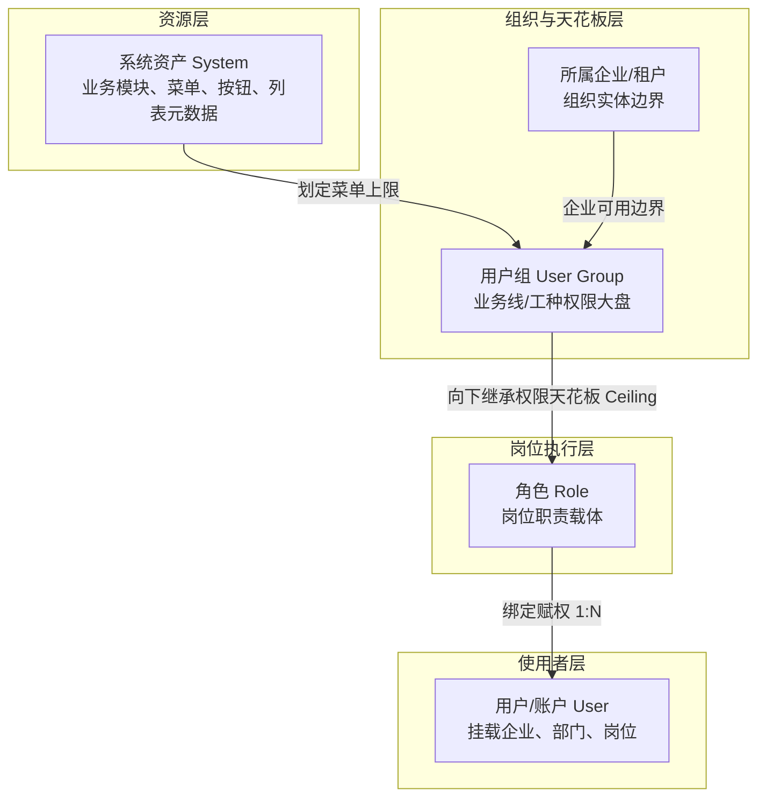
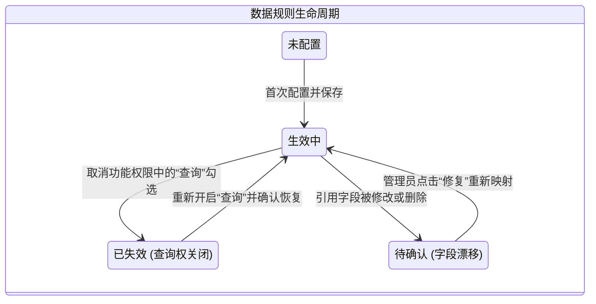

# 业务权限体系与细粒度数据过滤方案设计规范

---

## 1. 业务背景与系统现状

### 1.1 系统与组织架构现状
当前系统采用多组织、多应用的 Monorepo 平台架构，服务于数字金融与供应链协同业务。系统内账户分为平台管理、平台普通用户、企业管理、企业普通用户等不同层级，支持跨组织身份切换。

系统已具备以下基础链路：
$$\text{系统（System）} \longrightarrow \text{用户组（User Group）} \longrightarrow \text{角色（Role）} \longrightarrow \text{用户账号（User）}$$

- **系统（System）**：作为功能资产目录，维护系统下的全量目录、页面菜单与按钮资源。
- **用户组（User Group）**：作为业务线或工种的“权限上限（天花板）”，关联系统并划定可用菜单集合。
- **角色（Role）**：归属于指定企业和用户组，在用户组已授权的菜单范围内进行裁剪配置。
- **用户（User）**：具体使用者，挂载企业、部门及岗位信息，被赋予一个或多个角色。

### 1.2 现有方案痛点
1. **数据权限粒度较粗**：目前多依赖单选的数据范围（如全部数据、本部门、自定义部门等），属于全局静态单选模式，无法针对特定业务列表（如订单列表、融资申请列表、合同列表）单独配置精细的过滤规则。
2. **缺乏多边贸易切片能力**：在复杂的产业链协作中，企业之间存在上下游、买卖双边等动态合作关系，单一角色无法灵活应对“仅看合作方与我方关联切片数据”的诉求。
3. **运维配置成本高**：如果将所有菜单、按钮、行过滤规则、列脱敏策略强绑定在每个单独角色上，会导致平台管理员面对大量重复配置，配置效率低且易漏配。

---

## 2. 权限分层体系设计

为实现既严密防越权、又易维护扩展的架构，产品采用 **“四层收敛模型”**：



### 核心规则约束
1. **天花板校验（Ceiling Guard）**：角色所勾选的菜单与功能必须严格属于其所属用户组的已授权范围；用户组缩减范围时，角色对应权限联动置灰或提示越界。
2. **多身份动态计算**：用户登录时携带企业上下文，系统根据当前激活的身份与角色集动态解析权限。

---

## 3. 三维一体权限产品维度设计

产品设计将权限明确拆解为相互独立但逻辑关联的三个维度：

```mermaid
flowchart LR
    subgraph 维度一：功能权限
        F1[菜单/路由权限<br/>解决页面访问控制]
        F2[操作/按钮权限<br/>解决增删改查导出控制]
    end

    subgraph 维度二：行级数据权限
        R1[预设模式: 全部/本人/本部门/本企业]
        R2[自定义条件组: 字段 + 操作符 + 环境变量]
    end

    subgraph 维度三：列级数据权限
        C1[字段可见性: 可见 / 隐藏]
        C2[字段脱敏: 全掩码 / 保留首尾掩码]
    end

    AUTH[权限配置中心] --> F1 & F2
    AUTH --> R1 & R2
    AUTH --> C1 & C2
```

### 3.1 功能权限（菜单与按钮）
- **交互形式**：采用“权限名称 / 操作权限”两列表格布局。左列展示系统、目录与页面的树形折叠；右列水平铺开该页面的操作按钮（查询、新增、编辑、删除、导出、审核等）。
- **工具辅助**：提供展开/折叠、全选/反选、只看已选、只看越界项、关键字检索。

### 3.2 行级数据权限（数据范围与过滤）
- **按业务列表独立配置**：行规则不搞全系统一刀切，仅对当前角色持有“查询”权限的业务列表进行独立配置。
- **预设模式（高频 4 档）**：
  - `全部数据`：不加任何行过滤；
  - `仅本人`：过滤经办人/创建人为当前登录用户；
  - `本部门`：过滤部门为当前用户所在部门；
  - `本企业`：过滤企业为当前登录企业。
- **自定义条件组（可视化逻辑构建器）**：
  - **条件组之间为 OR**（满足任一条件组即放行数据）；
  - **组内条件之间为 AND**（必须同时满足）；
  - 条件项由 `字段` + `操作符`（等于、不等于、大于、小于、属于IN、介于BETWEEN、包含LIKE等） + `数值/系统动态变量` 组成。

### 3.3 列级数据权限（字段可见性与脱敏）
- **字段三态定义**：
  - `可见 (VISIBLE)`：正常查看与展示；
  - `不可见 (HIDDEN)`：表格列整列隐藏、详情项隐藏、导出数据不输出该字段；
  - `脱敏 (MASKED)`：展示掩码，支持全遮蔽（`***`）或保留首尾掩码（`1101**********1234`）。
- **安全兜底原则（Fail-Closed）**：系统新迭代上线的字段，默认策略强制为 `HIDDEN`，必须经管理员显式授权后才向相应角色放开。

---

## 4. 复杂多边供应链业务场景与规则推演

### 4.1 典型业务场景描述
在数字供应链金融场景中，各主体关系如下：
1. **企业 A 与 B**：普通入驻企业，A 只能看 A 的数据，B 只能看 B 的数据。
2. **企业 C**：C 是 A 和 B 的核心上游企业，C 需要能够穿透查看 A 和 B 的相关经营与单据数据。
3. **企业 D**：D 面对 A 时是买方（采购 A 的货物），面对 B 时是卖方（向 B 供货）。D 最终在单据列表中看到的，必须是“A 和 B 过滤切片出来与 D 关联的那一部分数据”，不能看到 A 卖给其他人或 B 从别人处采购的数据。

### 4.2 业务单据通用字段基础
标准的供应链业务单据（如订单、凭证、合同、发票）天然包含以下核心参与方字段：
- `belong_org_id`（单据所属企业）
- `seller_org_id`（卖方/供货企业）
- `buyer_org_id`（买方/采购企业）
- `upstream_org_id`（上游链条核心企业）

### 4.3 规则推演与配置实现

| 业务主体 | 业务目标 | 产品行级规则配置 (RowRule) | 底层执行推演与原理解析 |
| :--- | :--- | :--- | :--- |
| **企业 A** | 只能看 A 自己的数据 | 选预设档：**【本企业】** | `belong_org_id = $CURRENT_ORG_ID$`。<br>A 登录时系统环境变量动态带入 A，只看 A 的单据。 |
| **企业 B** | 只能看 B 自己的数据 | 选预设档：**【本企业】** | `belong_org_id = $CURRENT_ORG_ID$`。<br>B 登录时系统环境变量动态带入 B，只看 B 的单据。 |
| **企业 C** | C 是 A、B 上游，需看 A 和 B | **条件组 1**：<br>`belong_org_id IN $MY_DOWNSTREAM_ORGS$` | 系统根据企业关系网络动态计算出 C 的下游合作企业为 `[A, B]`，自动注入 `belong_org_id IN ('A', 'B')`。 |
| **企业 D** | 对 A 是买方，对 B 是卖方，看各自切片数据 | **条件组 1（作为买方）**：<br>`buyer_org_id = $CURRENT_ORG_ID$`<br>$\mathbf{OR}$ （满足任一组即可见）<br>**条件组 2（作为卖方）**：<br>`seller_org_id = $CURRENT_ORG_ID$` | ① 过滤 A 的全量订单：命中条件组 1，捞出 `买方=D` 的单据（A 卖给其他客户的被排除）；<br>② 过滤 B 的全量订单：命中条件组 2，捞出 `卖方=D` 的单据（B 向其他供应商采购的被排除）；<br>③ **综合结果**：D 看到的数据恰好是 A 和 B 与自身有关的切片子集。 |

### 4.4 配合列级脱敏防范商业泄密
即使 D 能查到与 A、B 发生交易的单据，A 与 B 的内部核心商业机密（如上游成本价、平台结算底价）仍需保护。
在列级策略中为企业 D 的角色配置：
- `交易数量`、`交收状态`、`合同编号` $\longrightarrow$ **`VISIBLE（可见）`**；
- `内部采购成本`、`毛利率`、`结算底分` $\longrightarrow$ **`HIDDEN（隐藏/导出不含）`**；
- `业务联系人手机/证件号` $\longrightarrow$ **`MASKED（脱敏掩码）`**。

通过**行过滤控范围、列脱敏控深度**，完整契合多边协同中的商业合规要求。

---

## 5. 平台管理操作便利性深度优化

如果所有规则都需要平台管理员逐个点进角色手动搭建表达式，维护成本极高。为此，产品设计进行以下 4 项解耦与自动化优化：

### 5.1 策略解耦：沉淀通用的【数据权限策略包】
将常用的过滤与脱敏规则抽离为独立的策略资产，定义一次、全平台复用：
- `【默认本企业隔离包】`：`belong_org_id = $CURRENT_ORG_ID$`；
- `【贸易双边协同包】`：`buyer = $CURRENT_ORG_ID$ OR seller = $CURRENT_ORG_ID$`；
- `【上游链条穿透包】`：`belong_org_id IN $MY_DOWNSTREAM_ORGS$`。

管理员为新角色或用户组分配权限时，**无需现场配置条件，直接下拉选用现成的策略包**。

### 5.2 多层级自动继承（80% 场景免配置）
建立 **企业级 $\longrightarrow$ 用户组级 $\longrightarrow$ 角色级** 的向下继承机制：

```
1. 企业/组织层（系统默认兜底，0 次点击）
   └─ 新增普通企业，系统默认绑定《默认本企业隔离包》；
   └─ 新增链上伙伴，系统默认绑定《贸易双边协同包》；
   └─ 开箱即用，管理员无需进行任何手动配置。

2. 用户组层（工种批量统一，1 次配置）
   └─ 在工种大盘（如风控组、出纳组）统一指定策略包；
   └─ 该组下所有角色自动继承，无需逐个重复选。

3. 角色层（仅用于特殊例外“差异覆写”）
   └─ 仅 5% 具有特殊跨权或强限制的个性化岗位，才在角色上做微调覆盖。
```

### 5.3 业务关系驱动（业务操作自动触发权限更新）
- 业务员在【供应链协同/合作关系管理】中，将企业 D 关联为 A 的买方、B 的卖方；
- **系统感知合作关系确立，底层自动激活双边数据切片能力**；
- 管理员无需去权限模块做任何重复配置，实现“业务发生即权限生效”。

### 5.4 反向视角：提供【列表资产维度】集中配置大盘
除了“进入角色找列表”的正向配置入口外，在“列表资产/菜单配置”中增加**反向矩阵视图**：

```
┌────────────────────────────────────────────────────────────────────────────────────────┐
│  资产管理 > 供应链订单列表 (biz_order_list) · 数据权限集中配置                         │
├───────────────────┬───────────────────────────────┬────────────────────────────────────┤
│ 角色 / 身份       │ 行级数据可见范围              │ 列级脱敏设置 (手机号 / 身份证 / 价格)│
├───────────────────┼───────────────────────────────┼────────────────────────────────────┤
│ 平台风控专员      │ [ 下拉选择: 全量数据包    ▼ ] │ 价格: 可见 ｜ 手机号: 可见         │
│ 企业管理员        │ [ 下拉选择: 本企业隔离包  ▼ ] │ 价格: 可见 ｜ 手机号: 脱敏         │
│ 供应链协同方(D)   │ [ 下拉选择: 贸易双边协同包▼ ] │ 价格: 隐藏 ｜ 手机号: 脱敏         │
│ 基层业务员        │ [ 下拉选择: 仅本人数据包  ▼ ] │ 价格: 隐藏 ｜ 手机号: 脱敏         │
└───────────────────┴───────────────────────────────┴────────────────────────────────────┘
  [ 批量修改选中项 ]     [ 保存全表配置 ]
```
管理员在一个界面内即可纵览全平台所有身份对该列表的权限分布，支持批量调整，大幅降低维护成本。

---

## 6. 核心业务状态机与安全闭环



1. **查询权联动失效机制（Query Dependency）**：
   - 当在功能权限中取消勾选某个列表的“查询”按钮时，系统弹窗强确认；
   - 确认后，该列表对应的行级规则与列级策略自动置为 `INVALID（失效）`，防止“无页面访问权却残留数据策略”带来的逻辑混乱。
2. **Schema 漂移保护机制（Fail-Closed 原则）**：
   - 业务版本升级如果删除了某个字段或变更了字段类型，引用该字段的规则自动转为 `PENDING_CONFIRM（待确认）`；
   - 在管理员确认修复前，默认按 0 条数据拦截，防止直接抛出数据库异常导致前端页面崩溃。
3. **多角色合并逻辑**：
   - **功能权限**：取并集（Union），任一角色拥有操作权限即放行；
   - **行级数据**：取宽松（OR 拼接），任一角色为全量数据则看全量；
   - **列级数据**：可见性取最大（`VISIBLE > MASKED > HIDDEN`），脱敏算法取最严（全掩码优先于首尾掩码）。

---

## 7. 实施演进与平滑迁移建议

1. **第一阶段：平滑向下兼容**
   - 现有系统中的全局 `dataScope`（部门树单选）继续保留，作为未独立配置列表的全局兜底策略；已运行功能不受任何影响。
2. **第二阶段：策略包解耦与核心业务列表试点**
   - 沉淀公共策略包模板，在订单、融资、合同等核心列表中推行列表级行过滤与列脱敏；
   - 引入企业类型默认策略包，实现基础企业的免配开箱即用。
3. **第三阶段：业务关系自动化与全景沙盒预览**
   - 打通供应链合作关系与数据切片的自动派发机制；
   - 推广权限沙盒预览功能（支持以目标角色身份模拟调用接口查看过滤与脱敏真实样本），形成完整的产品闭环。
